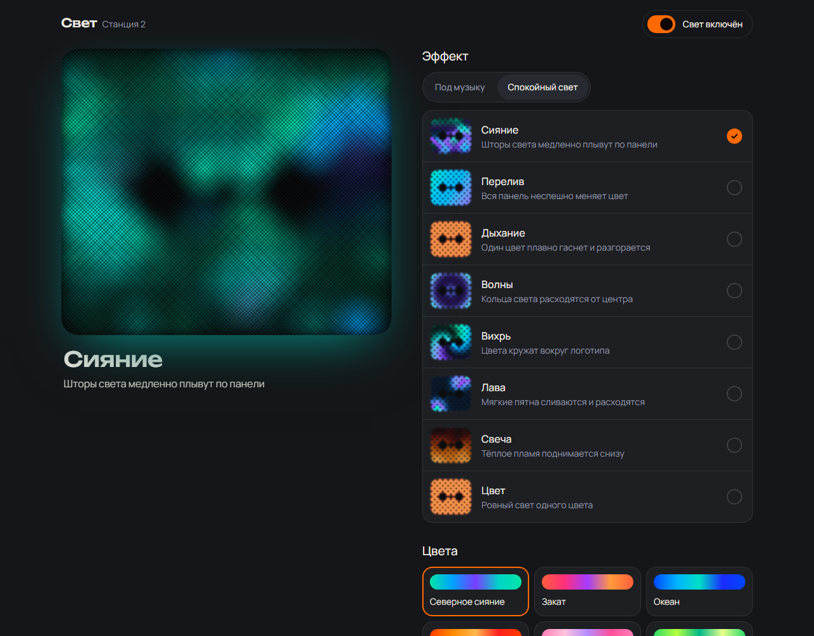
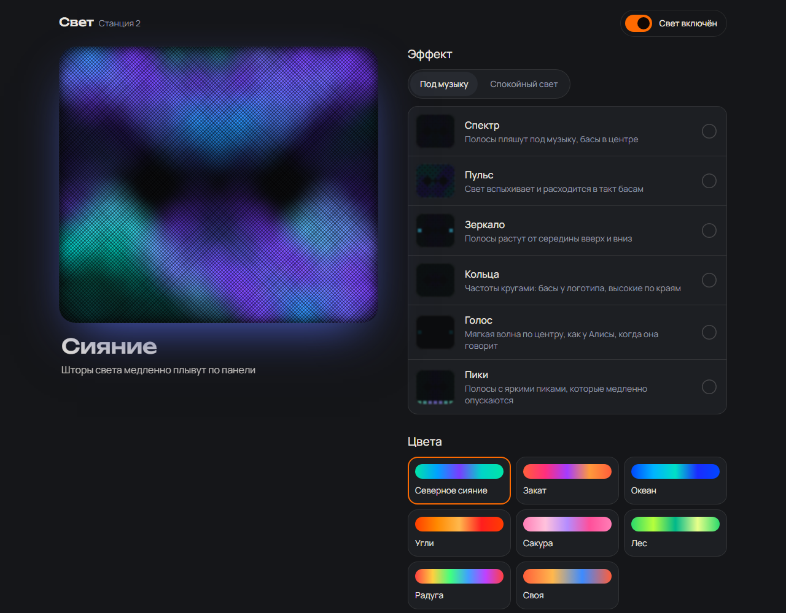
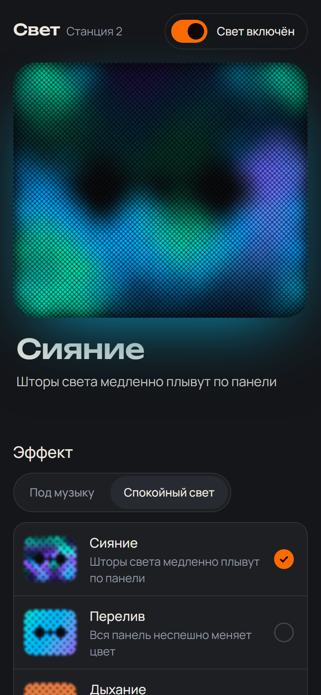

# Yandex Station Glow Reimagined

Плавная подсветка для **рутованной Яндекс Станции 2**: замена плагина `ledart`, который
дёргается. Программа рисует на 88 светодиодах панели (`/dev/fb0`, 89×1, RGBW) со скоростью 60 кадров в секунду и
даёт управлять собой через веб-панель на порту `:15321`.

- Плавные эффекты, готовые палитры и своя палитра, живые превью эффектов в панели. Настройки
  сохраняются в `/data/opt/glow/state.json`.
- Не мешает Алисе: следит за `maind.log` и отдаёт ей панель, пока она показывает свою анимацию.
- Подсветка под музыку («Спектр», «Пульс»): читает обратный канал динамика `hw:0,1`
  вместо пустого `arecord`, который запускает `/etc/init.d/S40adc`. Если `hw:0,1` никто не читает,
  сторож в `S99zglow` возвращает пустой `arecord` (без него ломается эхоподавление).
- `S99zyam` запускает `yamd` с `--model yandexstation_2`, чтобы работал плагин station-airplay.



| Под музыку | На телефоне |
|---|---|
|  |  |

**Пошаговая установка с нуля:** [docs/GUIDE.md](docs/GUIDE.md).
**Для нейросетей и AI-ассистентов** (устройство кода, API, железо, правила):
[AGENTS.md](AGENTS.md).

## Благодарности

Рут, доступ к станции и всё, на чём это стоит: вики и проект
[Marker284/yandex-station-extended](https://github.com/Marker284/yandex-station-extended)
([hackalice.me](https://hackalice.me)). Без него ничего этого не было бы.

## Сборка

Нужен Go 1.27+. Собирается без cgo под arm64:

```sh
GOOS=linux GOARCH=arm64 CGO_ENABLED=0 go build -buildvcs=false -trimpath -ldflags="-s -w" -o build/glow .
```

В PowerShell:

```powershell
$env:GOOS="linux"; $env:GOARCH="arm64"; $env:CGO_ENABLED="0"
go build -buildvcs=false -trimpath -ldflags="-s -w" -o build/glow .
```

Тесты запускаются на компьютере: `go test ./...`

`cmd/fbprobe` — утилита для замеров: с какой скоростью панель принимает кадры через `write(2)`
и как ведёт себя очередь кадров драйвера.

## Установка на станцию

Станция должна быть уже рутована по вики yandex-station-extended, и к ней должен быть доступ по ADB или SSH.

```sh
adb shell mkdir -p /data/opt/glow
adb push build/glow /data/opt/glow/glow
adb push deploy/S99zglow /etc/init.d/S99zglow
adb shell chmod +x /data/opt/glow/glow /etc/init.d/S99zglow
adb shell /etc/init.d/S99zglow start
```

Потом откройте `http://<адрес-станции>:15321`. Лог пишется в `/tmp/glow.log`.

Обновить бинарник: залейте его в `/tmp/glow.new`, перенесите поверх `/data/opt/glow/glow`
и выполните `/etc/init.d/S99zglow restart`.

Чтобы отключить автозапуск, удалите `/etc/init.d/S99zglow`. Если музыкальные эффекты не нужны,
запустите программу с флагом `-no-audio`: тогда `hw:0,1` она не трогает.

Автозапуск `yamd` (нужен, если установлен YAM и плагин station-airplay):

```sh
adb push deploy/S99zyam /etc/init.d/S99zyam
adb shell chmod +x /etc/init.d/S99zyam
```

API `yamd` слушает только `127.0.0.1:8099` и пароля не имеет.
